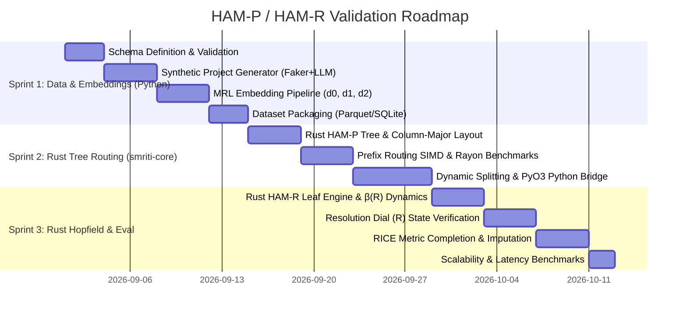

# HAM-P & HAM-R Sprint Roadmap & Engineering Strategy

## 1. Architectural Synthesis: The Unified HAM Engine

A central realization in designing scalable associative memory systems is that **HAM-P** and **HAM-R** are complementary solutions addressing orthogonal dimensions of memory access:

| Dimension | Engine | Role & Primary Objective |
| :--- | :--- | :--- |
| **Spatial Routing & Scaling** | **HAM-P** (*Partitioned Tree*) | Prunes 99% of irrelevant memories without inter-domain cross-talk or $O(M \cdot d)$ compute bottlenecks using Matryoshka prefix slicing. |
| **Synthesis & Granularity** | **HAM-R** (*Resolution Dial*) | Controls output dynamics within localized memory pools via inverse temperature $\beta(R)$, spanning global/cluster archetype blends to exact item recall. |

```
                              [ Unified Query: x ]
               MRL Embeddings: x[:64] (d0), x[:128] (d1), x[:768] (d2)
                                       │
                                       ▼
┌─────────────────────────────────────────────────────────────────────────────┐
│ HAM-P Spatial Tree Routing                                                  │
│                                                                             │
│   Layer 0 (Root Router, d0=64):                                             │
│     Inner product against category prototypes ──► Selects Subtree Branch    │
│                                                          │                  │
│   Layer 1 (Subcategory Router, d1=128):                  │                  │
│     Inner product against cluster centroids   ──► Pinpoints Leaf Pool       │
└──────────────────────────────────────────────────────────┼──────────────────┘
                                                           │
                                                           ▼
┌─────────────────────────────────────────────────────────────────────────────┐
│ HAM-R Leaf Pool Dynamics (Layer 2, d2=768, Leaf Size M_leaf ≈ 50-100)       │
│                                                                             │
│   Continuous Hopfield Retrieval with Resolution Dial R in [0.0, 1.0]:       │
│                                                                             │
│   β(R) = β_min + R * (β_max - β_min)                                        │
│   a = softmax(β(R) * (Ξ_leaf)^T * x[:768])                                  │
│   x_out = Ξ_leaf * a                                                        │
│                                                                             │
│   ┌───────────────────────┬───────────────────────┬─────────────────────┐   │
│   │ Low Dial (R < 0.3)    │ Mid Dial (0.3 <= R <= 0.7)│ High Dial (R > 0.7) │   │
│   ├───────────────────────┼───────────────────────┼─────────────────────┤   │
│   │ Broad Archetype Blend │ Metastable Cluster    │ Exact Isolated      │   │
│   │ (Domain Baseline)     │ Forecast (Consensus)  │ Precedent Recall    │   │
│   └───────────────────────┴───────────────────────┴─────────────────────┘   │
└─────────────────────────────────────────────────────────────────────────────┘
```

---

## 2. Testbed Domain: Enterprise Knowledge Graph (EKG) Project Nodes

To validate the unified engine empirically, we focus on **Enterprise Software Projects** as graph nodes, using **RICE scoring** ($R \times I \times C / E$) as a ground-truth metric testbed.

### Why This Domain Tests the Theory:
1. **Hierarchical Taxonomy:** Naturally mirrors enterprise portfolios (Domain $\to$ Sub-domain/Epic $\to$ Specific Initiative).
2. **Associative Completion (Imputation):** Allows testing if an incomplete project brief (e.g., Domain + Problem Statement + Reach) can recall/impute plausible estimates for Effort, Impact, Confidence, and Dependencies.
3. **Resolution Dial Verification:** Evaluates whether adjusting $R$ yields sensible transitions from broad industry baselines to fine-grained historical precedents.

---

---

## 3. Technology Stack & Language Boundary

```
┌─────────────────────────────────────────────────────────────────────────────┐
│ Python Layer (Data Engine & Evaluation)                                     │
│   • Data Modeling & Schemas: Pydantic, Faker                                │
│   • Synthetic Generation: Gemini Flash / Ollama LLM API                     │
│   • MRL Feature Encoding: PyTorch, HuggingFace (nomic-embed-text-v1.5)      │
│   • Evaluation & Analysis: Pandas, Scipy, Matplotlib                        │
└──────────────────────────────────────┬──────────────────────────────────────┘
                                       │ PyO3 / Maturin Bindings
                                       ▼
┌─────────────────────────────────────────────────────────────────────────────┐
│ Rust Core Engine (`smriti-core`)                                            │
│   • Memory Layout: Contiguous column-major buffers (Zero-allocation query)  │
│   • Hardware Acceleration: SIMD dot products (AVX2/AVX-512/Neon)            │
│   • Parallelism: Rayon multithreaded matrix-vector products                 │
│   • HAM-P Topology: Multi-layer tree with atomic node splitting             │
│   • HAM-R Dynamics: Continuous Hopfield leaf pools with inverse temp β(R)   │
│   • Concurrency: Fine-grained RwLock with background Copy-On-Write splits   │
└─────────────────────────────────────────────────────────────────────────────┘
```

---

## 4. Sprint Roadmap



### Summary of Sprints

- **[Sprint 1: Data Engine & MRL Embeddings Spike (Python)](./sprint-1-data-engine-mrl-spike.md)**
  - Define EKG Project schema (text context + RICE factors + relational tags).
  - Build synthetic generator (Faker for structural/quantitative metrics + cheap LLM for technical narratives).
  - Generate multi-resolution MRL embeddings using open-source models (`nomic-embed-text-v1.5` / `bge-base-en-v1.5`).
- **[Sprint 2: Rust HAM-P Tree Infrastructure & Routing Engine](./sprint-2-ham-p-tree-routing.md)**
  - Implement the core 3-layer HAM-P tree in **Rust** (`smriti-core`) with contiguous memory matrices and SIMD dot products.
  - Benchmark prefix routing recall ($d_0=64 \to d_1=128 \to d_2=768$) against flat $O(M \cdot d)$ brute force.
  - Implement online insertions, running-mean prototype updates, and dynamic 2-means leaf splitting in Rust with PyO3 bindings.
- **[Sprint 3: Rust Hopfield Dynamics, Resolution Dial & Evaluation](./sprint-3-hopfield-resolution-dial-eval.md)**
  - Implement the **Rust** HAM-R continuous Hopfield leaf engine with the Resolution Dial ($\beta(R)$).
  - Test energy landscape behavior across Resolution Dial settings ($R \in [0.0, 1.0]$) via Python bindings.
  - Run associative pattern completion to estimate RICE scores on unseen project drafts.
  - Compile latency, memory footprint, and recall benchmark report.

